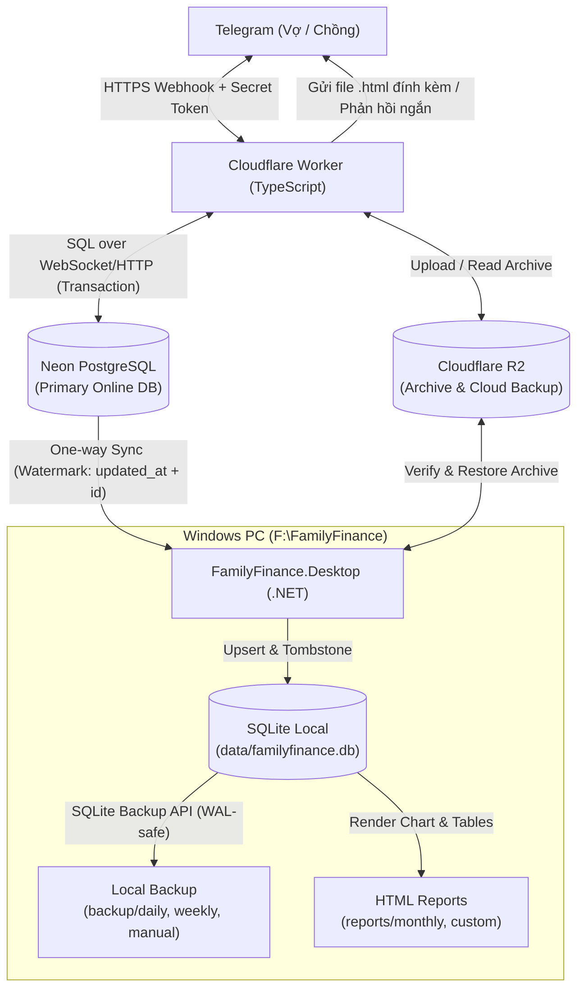

# FamilyFinance — Master Code Plan (v4.0 Unified)

> Bản kế hoạch code tổng thể được hợp nhất từ `FamilyFinance_Plan_MasterPrompt.md` (v2.0) và `FamilyFinance_Agent_Runbook_v3.md` (v3.0), đã được chủ dự án phê duyệt toàn bộ các điểm giao thoa về kiến trúc, mô hình dữ liệu và nghiệp vụ.

---

## 1. Tổng hợp Review & Các quyết định đã chốt

| Hạng mục | Bản v2.0 (`MasterPrompt`) | Bản v3.0 (`Agent_Runbook_v3`) | Quyết định hợp nhất (v4.0) |
| :--- | :--- | :--- | :--- |
| **Chiều dữ liệu thu/chi** | Chỉ có `nguoi_tao`, `danh_muc`, `tai_khoan`. | Tách rõ 4 chiều: **Người tạo** (`nguoi_tao_id`), **Người thực hiện** (`nguoi_thuc_hien_id`), **Người giữ tiền** (`nguoi_giu_tien_id`), **Đối tượng thụ hưởng** (`doi_tuong_thu_huong_id` / `phan_bo_giao_dich`). | Giữ đúng cột `nguoi_giu_tien_id` (`VO`, `CHONG`, `QUY_CHUNG`, `CHUA_XAC_DINH`). **Q2**: câu nói rõ người giữ ("tiền vợ giữ", "lấy quỹ chung") → theo câu; không nói → **người giữ = người thực hiện** ("lương chồng" → `CHONG`; không nêu ai → người nhắn). Ghi `HOAN_TAT` ngay, không hỏi lại `NGUOI_GIU_TIEN` cho THU/CHI thường; chỉ chuyển tiền nội bộ mới cần xác nhận (Phase 4). *(Đổi ngày 04/11/2026, thay "Hướng B" — trước đó bot hỏi lại khi câu không nói ai giữ tiền.)* |
| **Chuyển tiền nội bộ** | Chỉ nêu khái niệm `CHUYEN_QUY`. | Quy trình xác nhận 2 chiều chặt chẽ giữa Vợ và Chồng qua inline button (`CHO_XAC_NHAN` → `DA_XAC_NHAN` / `TU_CHOI`), không làm đổi tổng tiền gia đình. | **Lấy theo v3.0** (bảng `chuyen_tien_noi_bo` + callback query xác thực đúng `telegram_user_id` người nhận). |
| **Quản lý Vay / Trả nợ** | Có bảng `khoan_no` và `lich_su_no` để theo dõi dư nợ gốc, đối tượng vay/cho vay. | Có liệt kê loại `VAY`, `TRA_NO`, `LAI_VAY` ở mục 9 nhưng thiếu bảng ở mục 8. | **Gộp cả v2.0 + v3.0**: Giữ đủ 2 bảng `khoan_no` và `lich_su_no` liên kết với `giao_dich`. |
| **Ranh giới TypeScript vs .NET** | Đặt `FamilyFinance.Core` (C#) chứa Parser, gây chồng chéo với Worker TypeScript. | Nêu tách bạch qua API và hợp đồng dữ liệu (`shared/contracts`). | **Worker (TypeScript)** đảm nhận toàn bộ Webhook, Parser tiếng Việt, Nghiệp vụ Bot, API đồng bộ và xuất HTML nhanh trên Telegram. **Desktop (.NET 9)** chuyên trách Sync (`Neon → SQLite`), Backup/Restore, Archive R2 và xuất Báo cáo HTML/Quản trị cục bộ. |
| **Báo cáo HTML** | Tạo trên máy local và đọc cả archive. | Nêu chi tiết các bảng/biểu đồ theo người thực hiện, đối tượng thụ hưởng, danh mục, chuyển tiền. | **Hỗ trợ cả 2 nơi**: Worker có thể trả lời text hoặc gửi file `.html` đính kèm ngay trong Telegram; App .NET xuất file báo cáo đầy đủ ra `F:\FamilyFinance\reports\`. |
| **Cấu trúc Git & Thư mục** | Đặt `.git` trong `source\`. | Chỉ đưa `source\` lên GitHub, `.git` hiện đang ở `F:\FamilyFinance\.git`. | **Giữ `.git` tại `F:\FamilyFinance\`**, thiết lập `.gitignore` chặn tuyệt đối mọi thư mục ngoài `source/` (`data/`, `backup/`, `reports/`, `logs/`, `temp/`, `config/*.local.json`). |

---

## 2. Kiến trúc hệ thống & Cấu trúc thư mục chuẩn

### 2.1. Sơ đồ luồng dữ liệu



### 2.2. Cấu trúc thư mục tại `F:\FamilyFinance\`

```text
F:\FamilyFinance\
├── .git\                                  # Git repo tại root (chỉ track source/, .gitignore, *.md)
├── .gitignore                             # Chặn toàn bộ data, backup, reports, logs, secrets
├── FamilyFinance_Plan_MasterPrompt.md     # Tài liệu v2.0 (giữ nguyên lịch sử)
├── FamilyFinance_Agent_Runbook_v3.md      # Tài liệu v3.0 (giữ nguyên lịch sử)
├── FamilyFinance_Master_Code_Plan_v4.md   # Tài liệu hợp nhất v4.0
├── source\
│   ├── backend\                           # Cloudflare Worker (TypeScript + Wrangler + Vitest)
│   │   ├── src\
│   │   │   ├── index.ts                   # Entrypoint: Webhook & Sync/Admin API routes
│   │   │   ├── config\                    # Env bindings, constants, timezone Asia/Ho_Chi_Minh
│   │   │   ├── auth\                      # Telegram secret token & user_id whitelist guard
│   │   │   ├── parser\                    # Bộ phân tích tiếng Việt (số tiền, ngày, loại, người, đối tượng, danh mục)
│   │   │   ├── bot\                       # Luồng hội thoại, inline keyboard xác nhận, callback handler
│   │   │   ├── services\                  # TransactionService, TransferService, BalanceService, DebtService, QueryService
│   │   │   ├── reports\                   # HTML generator gửi trực tiếp qua Telegram
│   │   │   └── db\                        # Neon client, repositories, transaction wrapper
│   │   ├── migrations\                    # SQL migrations chuẩn cho PostgreSQL (0001_init.sql, ...)
│   │   ├── seeds\                         # Dữ liệu mẫu giả (danh mục, đối tượng, từ khóa)
│   │   ├── tests\                         # Unit & Integration tests (Vitest)
│   │   ├── wrangler.toml.example
│   │   └── package.json
│   │
│   ├── desktop\                           # Ứng dụng Windows (.NET C#)
│   │   ├── FamilyFinance.sln
│   │   ├── FamilyFinance.Core\            # DTOs, Sync contracts, Report models, Archive manifest models
│   │   ├── FamilyFinance.Data\            # SQLite context/Dapper, SQLite migrations, WAL-safe Backup service
│   │   ├── FamilyFinance.Sync\            # One-way sync engine (Neon API/DB -> SQLite), R2 Archive verifier
│   │   ├── FamilyFinance.Reports\         # Bộ kết xuất HTML/CSS/JS offline từ SQLite + Archive
│   │   ├── FamilyFinance.App\             # CLI / Windows Runner (sync, backup, restore, report, dry-run)
│   │   └── FamilyFinance.Tests\           # xUnit tests cho Sync, Backup, Report, Idempotency
│   │
│   ├── shared\
│   │   ├── contracts\                     # JSON Schema, Enum chuẩn, bộ Test Cases JSON dùng chung
│   │   └── templates\                     # HTML/CSS/JS template cho báo cáo
│   │
│   ├── docs\                              # Tài liệu kiến trúc, ERD, vận hành, khôi phục
│   └── scripts\                           # Script hỗ trợ build, test, kiểm tra secret trước commit
│
├── config\                                # [IGNORED] Chứa appsettings.local.json (ngoài Git)
├── data\                                  # [IGNORED] Chứa familyfinance.db (SQLite thật)
├── backup\                                # [IGNORED] daily\, weekly\, manual\
├── reports\                               # [IGNORED] monthly\, custom\
├── logs\                                  # [IGNORED] Log đồng bộ và vận hành local
└── temp\                                  # [IGNORED] Thư mục tạm khi giải nén/kiểm tra archive
```

---

## 3. Thiết kế Cơ sở dữ liệu Hợp nhất (15 Bảng)

Tất cả các trường tiền tệ bắt buộc dùng `BIGINT` (PostgreSQL) / `INTEGER` 64-bit (SQLite), đơn vị `VND` nguyên dương. Mọi bảng đồng bộ đều có `id` (UUID/ULID), `created_at`, `updated_at`, `version` (BIGINT tăng dần hoặc watermark) và `deleted_at` (soft-delete/tombstone).

### Nhóm 1: Thành viên, Số dư ban đầu & Đối tượng thụ hưởng
1. **`thanh_vien`**: `id` (`VO`, `CHONG`, ...), `ten`, `telegram_user_id` (UNIQUE, NOT NULL), `vai_tro`, `is_active`, `created_at`, `updated_at`, `version`.
2. **`so_du_ban_dau`**:
   - Lưu số tiền ban đầu của gia đình và phân bổ theo người giữ (`nguoi_giu_tien_id`: `VO`, `CHONG`, `QUY_CHUNG`, `CHUA_XAC_DINH`).
   - Cột: `id`, `nguoi_giu_tien_id`, `so_tien` (BIGINT), `ngay_ap_dung`, `nguoi_xac_nhan_id`, `ghi_chu`, `created_at`, `updated_at`, `version`.
3. **`doi_tuong_thu_huong`**: `id` (`VO`, `CHONG`, `CON_GAI`, `CON_TRAI`, `GIA_DINH`, ...), `ten_doi_tuong`, `loai_doi_tuong`, `quan_he`, `is_active`, `created_at`, `updated_at`, `version`.
4. **`tu_khoa_doi_tuong`**: `id`, `doi_tuong_id`, `tu_khoa`, `normalized_keyword` (UNIQUE), `nguoi_xac_nhan_id`, `created_at`, `updated_at`, `version`. *(Giúp nhận diện "bé lớn", "con gái", "chị hai" -> `CON_GAI`)*.

### Nhóm 2: Danh mục & Từ khóa
5. **`danh_muc`**: `id`, `ma_danh_muc` (UNIQUE), `ten_danh_muc`, `loai_giao_dich` (`THU`, `CHI`, `CA_HAI`), `mo_ta`, `is_active`, `created_at`, `updated_at`, `version`.
6. **`tu_khoa_danh_muc`**: `id`, `danh_muc_id`, `tu_khoa`, `normalized_keyword` (UNIQUE), `nguoi_xac_nhan_id`, `created_at`, `updated_at`, `version`.

### Nhóm 3: Giao dịch lõi, Phân bổ & Chuyển tiền nội bộ
7. **`tin_nhan_goc`**: `id`, `telegram_update_id` (UNIQUE), `telegram_message_id`, `telegram_chat_id`, `nguoi_gui_id`, `noi_dung_goc`, `thoi_gian_nhan`, `trang_thai_xu_ly` (`DA_NHAN`, `DA_GHI`, `CHO_XAC_NHAN`, `DA_BO_QUA`, `LOI`), `chi_tiet_loi`, `created_at`, `updated_at`, `version`.
8. **`giao_dich`**:
   - `id` (UUID)
   - `loai_giao_dich`: `THU`, `CHI`, `VAY`, `TRA_NO`, `LAI_VAY`, `PHI`, `DIEU_CHINH`
   - `so_tien` (BIGINT > 0)
   - `danh_muc_id` (nullable với `VAY`/`TRA_NO`/`DIEU_CHINH`)
   - `nguoi_tao_id` (FK -> `thanh_vien`, người gửi tin nhắn Telegram)
   - `nguoi_thuc_hien_id` (FK -> `thanh_vien`, người thực tế thực hiện THU/CHI)
   - `nguoi_giu_tien_id` (`VO`, `CHONG`, `QUY_CHUNG`, `CHUA_XAC_DINH`; câu không nói → = `nguoi_thuc_hien_id` theo Q2 04/11/2026; `HOAN_TAT` bắt buộc có — migration 0002), `chieu_dieu_chinh` (`TANG`/`GIAM`, chỉ cho `DIEU_CHINH` — migration 0002)
   - `doi_tuong_thu_huong_id` (FK -> `doi_tuong_thu_huong`, nullable nếu dùng phân bổ nhiều đối tượng)
   - `khoan_no_id` (FK -> `khoan_no`, nullable, dùng khi `VAY`/`TRA_NO`/`LAI_VAY`)
   - `mo_ta`, `ngay_giao_dich` (DATE theo `Asia/Ho_Chi_Minh`)
   - `trang_thai` (`HOAN_TAT`, `CHO_XAC_NHAN`, `DA_HUY`)
   - `source_message_id` (FK -> `tin_nhan_goc`)
   - `idempotency_key` (UNIQUE)
   - `created_at`, `updated_at`, `version`, `deleted_at`
9. **`phan_bo_giao_dich`**: `id`, `giao_dich_id` (FK), `doi_tuong_id` (FK), `so_tien_phan_bo` (BIGINT > 0), `ghi_chu`, `created_at`, `updated_at`, `version`, `deleted_at`.
10. **`chuyen_tien_noi_bo`**:
    - `id`, `nguoi_chuyen_id`, `nguoi_nhan_id`
    - `so_tien` (BIGINT > 0), `ngay_chuyen`
    - `trang_thai`: `CHO_XAC_NHAN`, `DA_XAC_NHAN`, `TU_CHOI`, `DA_HUY`, `HET_HAN`
    - `ngay_xac_nhan`, `telegram_user_id_xac_nhan`
    - `source_message_id`, `idempotency_key` (UNIQUE), `ghi_chu`
    - `created_at`, `updated_at`, `version`, `deleted_at`

### Nhóm 4: Quản lý Khoản nợ (Vay / Cho vay)
11. **`khoan_no`**: `id`, `ten_khoan_no`, `chieu_no` (`DI_VAY`, `CHO_VAY`), `doi_tac`, `so_tien_goc` (BIGINT), `du_no_hien_tai` (BIGINT), `ngay_phat_sinh`, `ngay_dao_han`, `trang_thai` (`DANG_NO`, `DA_TAT_TOAN`, `DA_HUY`), `ghi_chu`, `created_at`, `updated_at`, `version`.
12. **`lich_su_no`**: `id`, `khoan_no_id` (FK), `giao_dich_id` (FK), `loai_bien_dong` (`GIAI_NGAN`, `TRA_GOC`, `TRA_LAI`, `DIEU_CHINH`), `so_tien` (BIGINT), `ngay_ghi_nhan`, `ghi_chu`, `created_at`, `updated_at`, `version`.

### Nhóm 5: Xác nhận, Audit, Đồng bộ & Archive
13. **`yeu_cau_xac_nhan`**: `id`, `source_message_id`, `nguoi_tao_id`, `nguoi_can_xac_nhan_id`, `loai_xac_nhan` (`CHUYEN_TIEN`, `NGUOI_GIU_TIEN`, `DANH_MUC_MOI`, `DOI_TUONG_MOI`, `PHAN_BO`, `GIAO_DICH_MO_HO`), `du_lieu_de_xuat_json`, `trang_thai` (`CHO_XAC_NHAN`, `DA_XAC_NHAN`, `TU_CHOI`, `HET_HAN`), `expires_at`, `created_at`, `updated_at`, `version`.
14. **`lich_su_chinh_sua`** *(Audit log)*: `id`, `ten_bang`, `ban_ghi_id`, `hanh_dong` (`CREATE`, `UPDATE`, `CANCEL`, `CONFIRM`, `ARCHIVE`), `du_lieu_truoc_json`, `du_lieu_sau_json`, `nguoi_thuc_hien_id`, `ly_do`, `created_at`, `version`.
15. **`dong_bo` & `archive_manifest`**:
    - `dong_bo`: `id`, `ma_may_local`, `ten_bang`, `last_updated_at`, `last_record_id`, `last_version`, `trang_thai`, `so_ban_ghi_dong_bo`, `loi_cuoi`, `updated_at`.
    - `archive_manifest`: `id`, `ky_thang` (`YYYY-MM`), `r2_object_key`, `schema_version`, `row_counts_json`, `tong_thu` (BIGINT), `tong_chi` (BIGINT), `sha256_checksum`, `trang_thai` (`DA_TAO`, `DA_XAC_MINH`, `LOI`), `verified_at`, `created_at`.

---

## 4. Quy tắc Nghiệp vụ & Công thức Tính toán Cốt lõi

### 4.1. Bốn nguyên tắc vàng về Dòng tiền & Số dư
1. **Tổng thu nhập kỳ** = $\sum \text{so\_tien}$ của các bản ghi `giao_dich` có `loai_giao_dich = 'THU'` và `trang_thai = 'HOAN_TAT'`.
2. **Tổng chi tiêu kỳ** = $\sum \text{so\_tien}$ của các bản ghi `giao_dich` có `loai_giao_dich IN ('CHI', 'LAI_VAY', 'PHI')` và `trang_thai = 'HOAN_TAT'`.
3. **Số tiền đang giữ theo từng nhóm (`VO`, `CHONG`, `QUY_CHUNG`, `CHUA_XAC_DINH`)**:
   $$\text{Tiền đang giữ}(M) = \text{Số dư ban đầu}(M) + \sum \text{THU/VAY vào } M - \sum \text{CHI/TRA\_NO/LAI\_VAY/PHI từ } M \pm \sum \text{DIEU\_CHINH}(M) + \sum \text{Chuyển nội bộ ĐÃ XÁC NHẬN nhận vào } M - \sum \text{Chuyển nội bộ ĐÃ XÁC NHẬN chuyển đi từ } M$$
4. **Tổng tiền gia đình hiện có**:
   - $\text{Số dư gia đình} = \text{Số dư ban đầu gia đình} + \text{Tổng THU} - \text{Tổng CHI} + \text{VAY} - \text{TRA\_NO} \pm \text{DIEU\_CHINH}$.
   - Tổng số tiền các nhóm đang giữ (`VO + CHONG + QUY_CHUNG + CHUA_XAC_DINH`) luôn khớp với Tổng số dư gia đình.
   - Khi chuyển tiền nội bộ giữa Vợ và Chồng được xác nhận (`DA_XAC_NHAN`), tiền người chuyển giảm $X$, tiền người nhận tăng $X$ $\Rightarrow$ **Tổng tiền gia đình giữ nguyên không đổi** và **tuyệt đối không cộng vào Tổng THU hay Tổng CHI**.

### 4.2. Quy tắc Parser tiếng Việt tự nhiên (trên Cloudflare Worker)
Bộ Parser xử lý theo pipeline 6 bước tất định (deterministic, không dùng LLM tự do sinh SQL):
1. **Chuẩn hóa chuỗi**: Giữ nguyên bản gốc để lưu `tin_nhan_goc`, đồng thời tạo bản chuẩn hóa (trim, chuẩn hóa Unicode NFC, bản bỏ dấu để so khớp alias).
2. **Phân loại Intent**:
   - Câu hỏi / Truy vấn (`?`, `bao nhiêu`, `liệt kê`, `báo cáo`, `so sánh`, `còn bao nhiêu`, `lịch sử`).
   - Chuyển tiền nội bộ (`chuyển vợ`, `chuyển chồng`, `ck cho vợ`, `đưa vợ`, `đưa chồng`).
   - Ghi nhận giao dịch (`THU`, `CHI`, `VAY`, `TRẢ NỢ` hoặc câu ngắn như `tiền ăn 50k`, `lương 20tr`).
3. **Trích xuất Số tiền VND**:
   - Hỗ trợ: `50k`, `50 nghìn`, `50 ngàn`, `1tr`, `1 triệu`, `1tr5`, `1.5 triệu`, `2,5tr`, `1.200.000`, `1,200,000d`, `500.000đ`.
   - Chặn lỗi nhập mơ hồ (ví dụ có 2 con số khác nhau trong cùng câu mà không phải ngày tháng $\rightarrow$ hỏi lại).
4. **Trích xuất Thời gian**:
   - Hỗ trợ: `hôm nay`, `hôm qua`, `hôm kia`, `dd/mm`, `dd/mm/yyyy`, `ngày dd/mm`. Mặc định lấy ngày hiện tại theo `Asia/Ho_Chi_Minh`.
5. **Xác định 4 vai trò (Người tạo, Người thực hiện, Người giữ tiền, Đối tượng thụ hưởng)**:
   - `nguoi_tao_id`: Lấy trực tiếp từ `telegram_user_id` của người nhắn.
   - `nguoi_thuc_hien_id`: Nếu câu có cụm chỉ người thực hiện (`chồng trả`, `chồng thanh toán`, `chồng mua`, `vợ mua`, `vợ trả`, `lương chồng`, `lương vợ`) $\rightarrow$ gán theo người được nêu; nếu không có $\rightarrow$ mặc định bằng `nguoi_tao_id`.
   - `nguoi_giu_tien_id` (Q2): câu nói rõ người giữ ("tiền vợ giữ", "lấy quỹ chung") → theo câu; không nói → **người giữ = người thực hiện** ("lương chồng" → `CHONG`; không nêu ai → người nhắn). Ghi `HOAN_TAT` ngay, không hỏi lại `NGUOI_GIU_TIEN` cho THU/CHI thường; chỉ chuyển tiền nội bộ mới cần xác nhận (Phase 4). *(Đổi ngày 04/11/2026, thay "Hướng B" — trước đó bot hỏi lại khi câu không nói ai giữ tiền.)*
   - `doi_tuong_thu_huong_id`: Tìm theo từ khóa đối tượng (`cho con gái`, `của con trai`, `cho các con`, `cho vợ`, `cho chồng`). Nếu là `cho các con` (nhiều đối tượng) mà chưa nêu số tiền từng con $\rightarrow$ hỏi phân bổ hoặc lưu trạng thái chờ phân bổ theo xác nhận.
6. **Tra cứu Danh mục (`danh_muc`)**:
   - Khớp chính xác hoặc khớp qua bảng `tu_khoa_danh_muc` đã được xác nhận.
   - Nếu từ khóa mới chưa có trong DB $\rightarrow$ tạo `yeu_cau_xac_nhan` kèm Inline Keyboard gợi ý các danh mục gần nhất để người dùng bấm chọn và hỏi có lưu làm từ khóa mặc định cho lần sau không.

---

## 5. Lộ trình Triển khai 10 Phase

- **Phase 0 — Khảo sát môi trường & Chuẩn hóa Git/Cấu trúc**:
  - Kiểm tra Node.js, npm, .NET SDK, Git trên máy.
  - Tạo `.gitignore` gốc tại `F:\FamilyFinance\.gitignore`, cấu trúc thư mục khung `source\`, `config\`, `data\`, `backup\`, `reports\`, `logs\`.
  - Xuất `source/docs/ENVIRONMENT_AUDIT.md` và `FamilyFinance_Master_Code_Plan_v4.md`.
- **Phase 1 — Thiết kế Schema, ERD & Hợp đồng dữ liệu (`shared/contracts`)**:
  - Viết SQL Migration `0001_initial_schema.sql` cho PostgreSQL và SQLite (15 bảng, indexes, constraints).
  - Tạo seed dữ liệu mẫu (2 thành viên Vợ/Chồng mẫu, số dư ban đầu mẫu, danh mục THU/CHI cơ bản, đối tượng thụ hưởng mẫu).
  - Tạo tài liệu ERD (`source/docs/DATABASE_DESIGN.md`) và bộ test cases JSON chuẩn tại `source/shared/contracts/parser-test-cases.json`.
- **Phase 2 — Khởi tạo Backend Cloudflare Worker & Core Parser (TypeScript)**:
  - Khởi tạo project TypeScript trong `source/backend/`, cấu hình Vitest.
  - Xây dựng bộ **Vietnamese Finance Parser** (số tiền, ngày tháng, THU/CHI/VAY/CHUYỂN TIỀN, người thực hiện, người giữ tiền, đối tượng thụ hưởng, alias danh mục).
  - Chạy pass 100% unit tests cho mọi biến thể câu tiếng Việt có dấu / không dấu.
- **Phase 3 — Data Access Layer (Neon PostgreSQL) & Nghiệp vụ THU/CHI/Nợ**:
  - Xây dựng Repository & Service layer với Transaction, Idempotency (`idempotency_key` + `telegram_update_id`), Audit log (`lich_su_chinh_sua`).
  - Triển khai tính toán Số dư gia đình, Số tiền đang giữ theo từng nhóm, và quản lý Khoản nợ (`khoan_no`, `lich_su_no`).
- **Phase 4 — Chuyển tiền nội bộ & Luồng xác nhận 2 chiều + Phân bổ đối tượng**:
  - Xây dựng `TransferService` (`CHO_XAC_NHAN` $\rightarrow$ gửi inline button cho người nhận $\rightarrow$ kiểm tra đúng `telegram_user_id` người nhận $\rightarrow$ `DA_XAC_NHAN` / `TU_CHOI` / `DA_HUY`).
  - Xây dựng `AllocationService` cho giao dịch nhiều đối tượng thụ hưởng (`phan_bo_giao_dich`).
- **Phase 5 — Telegram Webhook, Bot Handler & Truy vấn tự nhiên (Query Engine)**:
  - Tích hợp Webhook HTTPS, xác thực header `X-Telegram-Bot-Api-Secret-Token` và whitelist `telegram_user_id`.
  - Xây dựng bộ giải nghĩa câu hỏi thống kê tự nhiên (theo ngày/tuần/tháng/năm/khoảng ngày, theo người thực hiện, theo đối tượng thụ hưởng, theo danh mục, so sánh tháng, số dư đang giữ).
  - Phản hồi ngắn gọn sau khi ghi nhận giao dịch; không spam báo cáo dài.
- **Phase 6 — Xuất Báo cáo HTML (trên cả Telegram & Template dùng chung)**:
  - Thiết kế mẫu báo cáo HTML responsive (bảng dữ liệu + biểu đồ Chart.js + fallback khi không có mạng + bộ lọc nhanh).
  - Cho phép bot gửi trực tiếp file `.html` qua Telegram khi người dùng gõ lệnh/yêu cầu xuất báo cáo.
- **Phase 7 — Ứng dụng Windows (.NET): SQLite & Đồng bộ 1 chiều (Neon $\rightarrow$ SQLite)**:
  - Khởi tạo solution `FamilyFinance.sln` trong `source/desktop/`.
  - Triển khai API/kết nối đồng bộ từ Neon về `F:\FamilyFinance\data\familyfinance.db` theo watermark (`updated_at`, `id`, `version`), hỗ trợ upsert, soft-delete (`deleted_at`), batch, retry và `--dry-run`.
- **Phase 8 — Backup an toàn (SQLite WAL) & Archive R2 có xác minh**:
  - Triển khai backup SQLite bằng SQLite Backup API (`daily`, `weekly`, `manual`), kiểm tra toàn vẹn `PRAGMA integrity_check` và test restore.
  - Triển khai luồng Archive tháng cũ lên R2 có `archive_manifest`, kiểm tra SHA-256 checksum, tổng dòng, tổng THU/CHI (mặc định không xóa dữ liệu gốc).
- **Phase 9 — Kết xuất Báo cáo HTML Offline trên Windows & CLI Quản trị**:
  - Kết xuất báo cáo HTML từ SQLite local (và đọc kèm file archive nếu truy vấn tháng cũ) ra `F:\FamilyFinance\reports\`.
  - Cung cấp lệnh CLI/Menu dễ dùng trên Windows: `sync`, `backup`, `restore-verify`, `report`, `status`.
- **Phase 10 — Kiểm thử tổng thể (E2E) & Tài liệu Vận hành / Chuyển máy**:
  - Kiểm thử toàn bộ các tiêu chí nghiệm thu ở mục 17 của Runbook v3 và mục 15 của MasterPrompt v2.
  - Hoàn thiện `OPERATIONS.md`, `RESTORE_GUIDE.md`, `NEW_MACHINE_SETUP.md`.

