# Thiết Kế Cơ Sở Dữ Liệu & Sơ Đồ Quan Hệ (ERD) — FamilyFinance v4.0

> Tài liệu thiết kế chi tiết cho cơ sở dữ liệu chính trên **Neon PostgreSQL** và bản sao cục bộ trên **SQLite (Windows PC)**.

---

## 1. Nguyên tắc thiết kế cốt lõi

1. **Không dùng số thực cho tiền tệ:** Mọi trường số tiền (`so_tien`, `so_tien_phan_bo`, `so_tien_goc`, `du_no_hien_tai`, `tong_thu`, `tong_chi`) bắt buộc dùng `BIGINT` (PostgreSQL) và `INTEGER` 64-bit (SQLite), lưu giá trị nguyên dương theo đơn vị `VND`.
2. **Định danh ổn định (Stable ID):** Các bảng danh mục/thành viên cố định dùng mã chuỗi chuẩn (`VO`, `CHONG`, `CON_GAI`, `THUC_AN`...), các bảng giao dịch và sự kiện dùng `UUID` (dạng chuỗi chuẩn 36 ký tự) để đồng bộ 1-1 giữa PostgreSQL và SQLite không bị lệch khóa ngoại.
3. **Chống ghi trùng (Idempotency):**
   - `tin_nhan_goc.telegram_update_id` là `UNIQUE`.
   - `giao_dich.idempotency_key` và `chuyen_tien_noi_bo.idempotency_key` là `UNIQUE`.
4. **Hỗ trợ đồng bộ 1 chiều (Neon → SQLite) & Xóa mềm (Tombstone):**
   - Mọi bảng đồng bộ đều có `created_at`, `updated_at`, `version` (`BIGINT` tăng dần) và `deleted_at` (nullable).
   - Khi hủy hoặc xóa giao dịch, không dùng lệnh `DELETE` vật lý mà cập nhật `trang_thai = 'DA_HUY'` hoặc gán `deleted_at`, tăng `version` để máy Windows đồng bộ về biết bản ghi đã hủy.
5. **Quy tắc `nguoi_giu_tien_id` (Q2, đổi 04/11/2026 thay "Hướng B"):**
   - Cột chỉ nhận `'VO'`, `'CHONG'`, `'QUY_CHUNG'`, `'CHUA_XAC_DINH'`; `NULL` chỉ còn ở dữ liệu cũ — migration 0002 chặn giao dịch `HOAN_TAT` thiếu người giữ.
   - Câu không nói ai giữ tiền → người giữ = người thực hiện.

---

## 2. Sơ đồ Thực thể Liên kết (ERD)

```mermaid
erDiagram
    thanh_vien ||--o{ tin_nhan_goc : "gửi"
    thanh_vien ||--o{ giao_dich : "tạo (nguoi_tao_id)"
    thanh_vien ||--o{ giao_dich : "thực hiện (nguoi_thuc_hien_id)"
    thanh_vien ||--o{ chuyen_tien_noi_bo : "chuyển (nguoi_chuyen_id)"
    thanh_vien ||--o{ chuyen_tien_noi_bo : "nhận (nguoi_nhan_id)"
    thanh_vien ||--o{ yeu_cau_xac_nhan : "cần xác nhận"

    danh_muc ||--o{ tu_khoa_danh_muc : "có alias"
    danh_muc ||--o{ giao_dich : "phân loại"

    doi_tuong_thu_huong ||--o{ tu_khoa_doi_tuong : "có alias"
    doi_tuong_thu_huong ||--o{ giao_dich : "thụ hưởng chính"
    doi_tuong_thu_huong ||--o{ phan_bo_giao_dich : "được phân bổ"

    tin_nhan_goc ||--o{ giao_dich : "sinh ra"
    tin_nhan_goc ||--o{ chuyen_tien_noi_bo : "sinh ra"
    tin_nhan_goc ||--o{ yeu_cau_xac_nhan : "cần hỏi lại"

    giao_dich ||--o{ phan_bo_giao_dich : "chia nhiều đối tượng"
    khoan_no ||--o{ giao_dich : "liên kết"
    khoan_no ||--o{ lich_su_no : "biến động nợ"
    giao_dich ||--o{ lich_su_no : "tạo biến động"

    thanh_vien {
        TEXT id PK "VO | CHONG | ..."
        TEXT ten
        BIGINT telegram_user_id UK
        TEXT vai_tro "VO | CHONG | QUAN_TRI"
        BOOLEAN is_active
        BIGINT version
    }

    so_du_ban_dau {
        TEXT id PK
        TEXT nguoi_giu_tien_id UK "VO | CHONG | QUY_CHUNG | CHUA_XAC_DINH"
        BIGINT so_tien
        DATE ngay_ap_dung
        TEXT nguoi_xac_nhan_id FK
        BIGINT version
    }

    danh_muc {
        TEXT id PK
        TEXT ma_danh_muc UK
        TEXT ten_danh_muc
        TEXT loai_giao_dich "THU | CHI | CA_HAI"
        BOOLEAN is_active
        BIGINT version
    }

    tu_khoa_danh_muc {
        TEXT id PK
        TEXT danh_muc_id FK
        TEXT tu_khoa
        TEXT normalized_keyword UK
        TEXT nguoi_xac_nhan_id FK
        BIGINT version
    }

    doi_tuong_thu_huong {
        TEXT id PK "VO | CHONG | CON_GAI | CON_TRAI | GIA_DINH"
        TEXT ten_doi_tuong
        TEXT loai_doi_tuong "CA_NHAN | NHOM_GIA_DINH | KHAC"
        TEXT quan_he
        BOOLEAN is_active
        BIGINT version
    }

    tu_khoa_doi_tuong {
        TEXT id PK
        TEXT doi_tuong_id FK
        TEXT tu_khoa
        TEXT normalized_keyword UK
        TEXT nguoi_xac_nhan_id FK
        BIGINT version
    }

    tin_nhan_goc {
        TEXT id PK
        BIGINT telegram_update_id UK
        BIGINT telegram_message_id
        BIGINT telegram_chat_id
        TEXT nguoi_gui_id FK
        TEXT noi_dung_goc
        TIMESTAMPTZ thoi_gian_nhan
        TEXT trang_thai_xu_ly
        BIGINT version
    }

    giao_dich {
        TEXT id PK
        TEXT loai_giao_dich "THU | CHI | VAY | TRA_NO | LAI_VAY | PHI | DIEU_CHINH"
        BIGINT so_tien
        TEXT danh_muc_id FK
        TEXT nguoi_tao_id FK
        TEXT nguoi_thuc_hien_id FK
        TEXT nguoi_giu_tien_id "VO | CHONG | QUY_CHUNG | CHUA_XAC_DINH | NULL"
        TEXT doi_tuong_thu_huong_id FK
        TEXT khoan_no_id FK
        TEXT mo_ta
        DATE ngay_giao_dich
        TEXT trang_thai "CHO_XAC_NHAN | HOAN_TAT | DA_HUY"
        TEXT source_message_id FK
        TEXT idempotency_key UK
        BIGINT version
    }

    phan_bo_giao_dich {
        TEXT id PK
        TEXT giao_dich_id FK
        TEXT doi_tuong_id FK
        BIGINT so_tien_phan_bo
        TEXT ghi_chu
        BIGINT version
    }

    chuyen_tien_noi_bo {
        TEXT id PK
        TEXT nguoi_chuyen_id FK
        TEXT nguoi_nhan_id FK
        BIGINT so_tien
        DATE ngay_chuyen
        TEXT trang_thai "CHO_XAC_NHAN | DA_XAC_NHAN | TU_CHOI | DA_HUY | HET_HAN"
        TIMESTAMPTZ ngay_xac_nhan
        BIGINT telegram_user_id_xac_nhan
        TEXT source_message_id FK
        TEXT idempotency_key UK
        BIGINT version
    }

    khoan_no {
        TEXT id PK
        TEXT ten_khoan_no
        TEXT chieu_no "DI_VAY | CHO_VAY"
        TEXT doi_tac
        BIGINT so_tien_goc
        BIGINT du_no_hien_tai
        DATE ngay_phat_sinh
        DATE ngay_dao_han
        TEXT trang_thai "DANG_NO | DA_TAT_TOAN | DA_HUY"
        BIGINT version
    }

    lich_su_no {
        TEXT id PK
        TEXT khoan_no_id FK
        TEXT giao_dich_id FK
        TEXT loai_bien_dong "GIAI_NGAN | TRA_GOC | THU_GOC | TRA_LAI | DIEU_CHINH"
        BIGINT so_tien
        DATE ngay_ghi_nhan
        BIGINT version
    }

    yeu_cau_xac_nhan {
        TEXT id PK
        TEXT source_message_id FK
        TEXT nguoi_tao_id FK
        TEXT nguoi_can_xac_nhan_id FK
        TEXT loai_xac_nhan "CHUYEN_TIEN | NGUOI_GIU_TIEN | DANH_MUC_MOI | DOI_TUONG_MOI | PHAN_BO | GIAO_DICH_MO_HO"
        TEXT du_lieu_de_xuat_json
        TEXT trang_thai "CHO_XAC_NHAN | DA_XAC_NHAN | TU_CHOI | HET_HAN"
        TIMESTAMPTZ expires_at
        BIGINT version
    }

    lich_su_chinh_sua {
        TEXT id PK
        TEXT ten_bang
        TEXT ban_ghi_id
        TEXT hanh_dong "CREATE | UPDATE | CANCEL | CONFIRM | ARCHIVE"
        TEXT du_lieu_truoc_json
        TEXT du_lieu_sau_json
        TEXT nguoi_thuc_hien_id FK
        TEXT ly_do
        BIGINT version
    }
```

---

## 3. Chi tiết các quy tắc toàn vẹn dữ liệu trong Schema

### 3.1. Ràng buộc trên bảng `giao_dich`
- `so_tien > 0`: Không bao giờ lưu số âm hoặc bằng 0.
- `loai_giao_dich IN ('THU', 'CHI', 'VAY', 'TRA_NO', 'LAI_VAY', 'PHI', 'DIEU_CHINH')`.
- `nguoi_giu_tien_id IS NULL OR nguoi_giu_tien_id IN ('VO', 'CHONG', 'QUY_CHUNG', 'CHUA_XAC_DINH')`.
- Khi `trang_thai = 'HOAN_TAT'`, giao dịch mới được đưa vào các truy vấn tổng hợp chính thức.
- **Phân bổ tạm bỏ (05/11/2026):** bảng `phan_bo_giao_dich` giữ nguyên để dùng sau, hiện không ghi; báo cáo theo đối tượng chỉ dựa `giao_dich.doi_tuong_thu_huong_id`. Khi dùng lại: khi một giao dịch sử dụng phân bổ nhiều đối tượng (`phan_bo_giao_dich`), tổng `so_tien_phan_bo` của các dòng active (`deleted_at IS NULL`) thuộc `giao_dich_id` đó phải bằng `giao_dich.so_tien`, đồng thời truy vấn tổng CHI gia đình chỉ cộng trên bảng `giao_dich` để **không bao giờ tính trùng**.

### 3.1b. Bảng `chuyen_quy_chung` (migration 0003 — bảng thứ 17)
- Nộp vào (`NOP`) / rút ra (`RUT`) quỹ chung, ghi ngay `HOAN_TAT` (huỷ → `DA_HUY`), không cần xác nhận.
- `thanh_vien_id` = người thao tác; `nhom_id` (`VO`/`CHONG`) = nhóm giữ tiền lúc ghi (snapshot, không suy lại qua `vai_tro`).
- Số dư nhóm: NOP → nhóm −X, `QUY_CHUNG` +X; RUT ngược lại. Không đổi tổng gia đình, không vào THU/CHI. `idempotency_key` UNIQUE (`tg:<update_id>`).

### 3.2. Ràng buộc trên bảng `chuyen_tien_noi_bo`
- `nguoi_chuyen_id <> nguoi_nhan_id`: Không thể tự chuyển cho chính mình.
- `so_tien > 0`.
- Chỉ khi `trang_thai = 'DA_XAC_NHAN'` (do đúng `telegram_user_id` của `nguoi_nhan_id` bấm xác nhận), khoản tiền mới làm giảm số tiền đang giữ của `nguoi_chuyen_id` và làm tăng số tiền đang giữ của `nguoi_nhan_id`.

### 3.3. Cơ chế Đồng bộ Watermark (`Neon PostgreSQL → SQLite`)
- Mỗi bảng có cột `updated_at` (ISO-8601 UTC) và `version` (`BIGINT`).
- Khi ứng dụng Windows đồng bộ một bảng $T$:
  - Đọc `(last_version, last_record_id)` từ bảng `dong_bo` local.
  - Truy vấn các bản ghi trên Neon có `(version > :last_version) OR (version = :last_version AND id > :last_record_id)` sắp xếp theo `ORDER BY version ASC, id ASC LIMIT :batch_size`.
  - Thực hiện `INSERT ... ON CONFLICT(id) DO UPDATE` trong một SQLite transaction kèm cập nhật bảng `dong_bo`.
  - Nhờ đó, chạy sync bao nhiêu lần cũng **idempotent 100%**, không bao giờ sót hoặc nhân đôi bản ghi.

